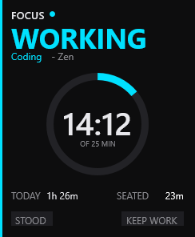

# Focus Rainmeter skin

Rainmeter focus tracker card (25 minute ring, state, keep-working hold).

The skin is an extension of [ActivityWatch](https://activitywatch.net/): it reads
the same window/app activity, uses the same category names and colours, and pairs
with `focus_aw_sync.py --push` so the focus stretches and the ActivityWatch
timeline stay in step. Focus adds the things ActivityWatch does not show on the
desktop: the current work stretch, a 25 minute ring, seated time, the 45 minute
break warning and a manual keep-working hold.

The skin is also a read-only viewer. It polls a single pipe-separated status file
written by a local daemon; no credentials or account data live here.

## Install

1. Copy this folder into `Documents\Rainmeter\Skins\Focus`.
2. Load `Focus.ini` from the Rainmeter manager.
3. Set your toolkit folder under `[Variables]` in the ini:

   ```ini
   ToolsRoot=C:\Tools
   ```

   The skin expects its toolkit under `%ToolsRoot%\focus`: `focus.py`, the venv
   and `logs\focus_status.txt`. The Lua helpers (`stale.lua`, `timer.lua`) have a
   `PATH` constant near the top with the same value in forward-slash form.

## Configuration

| Variable | Default | Meaning |
| --- | --- | --- |
| `ToolsRoot` | `C:\Tools` | Folder holding the focus toolkit |
| `ColorCoding` ... `ColorPlay` | ActivityWatch palette | Category colours, identical to the ActivityWatch categories |
| right-click menu | | Mark app as work/play, grace 5/10/15 min, hold on/off |

Status file contract (`logs\focus_status.txt`, 15 pipe-separated fields):

```
state|project|app|stretch|work_today|work_week|day_bars|seated|break_due|idle_s|paused|written|error|stretch_s|held
```

`state` is `working`, `notworking`, `idle` or `paused`; `written` is epoch
seconds. The card shows STALE or OFFLINE instead of inventing data when the
daemon stops writing.
